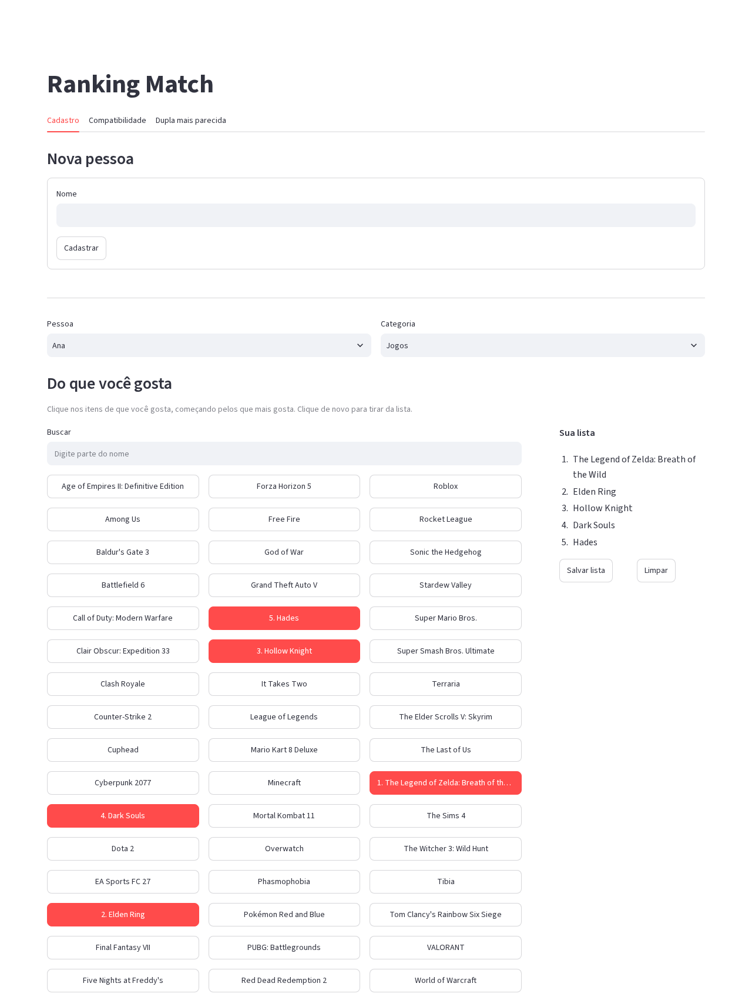
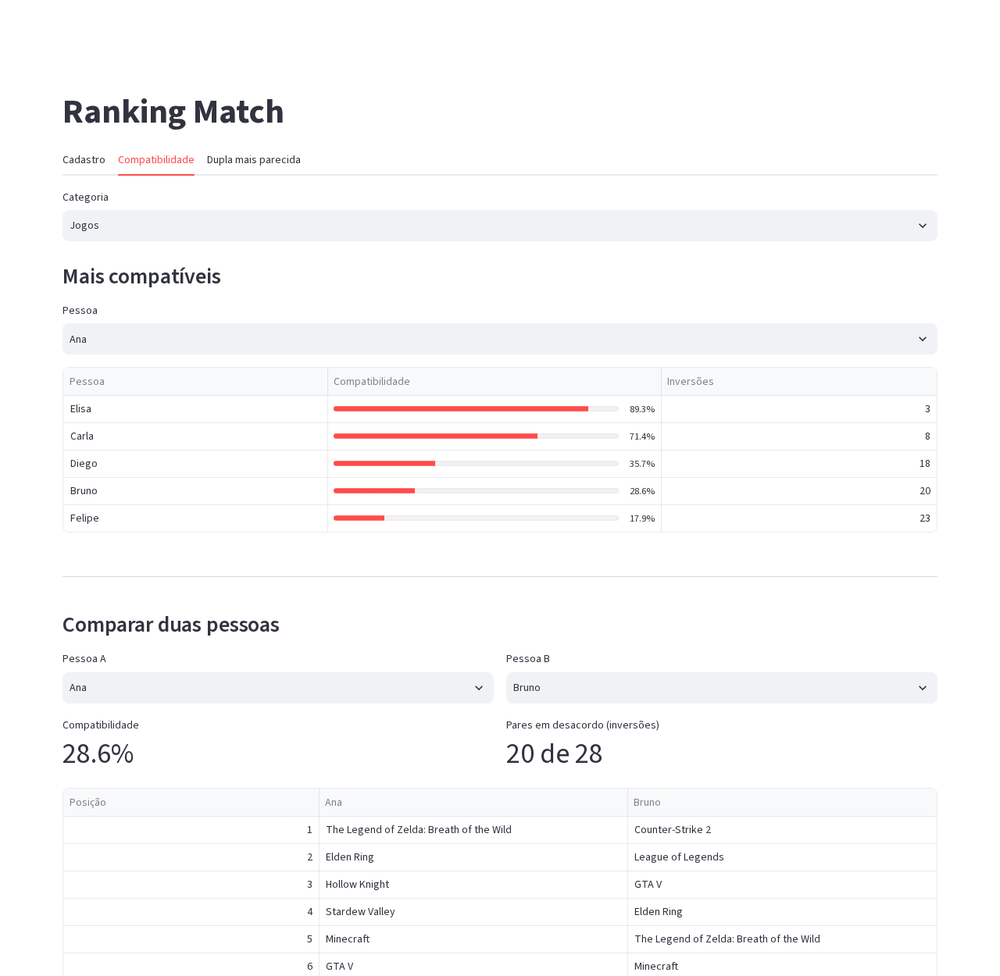
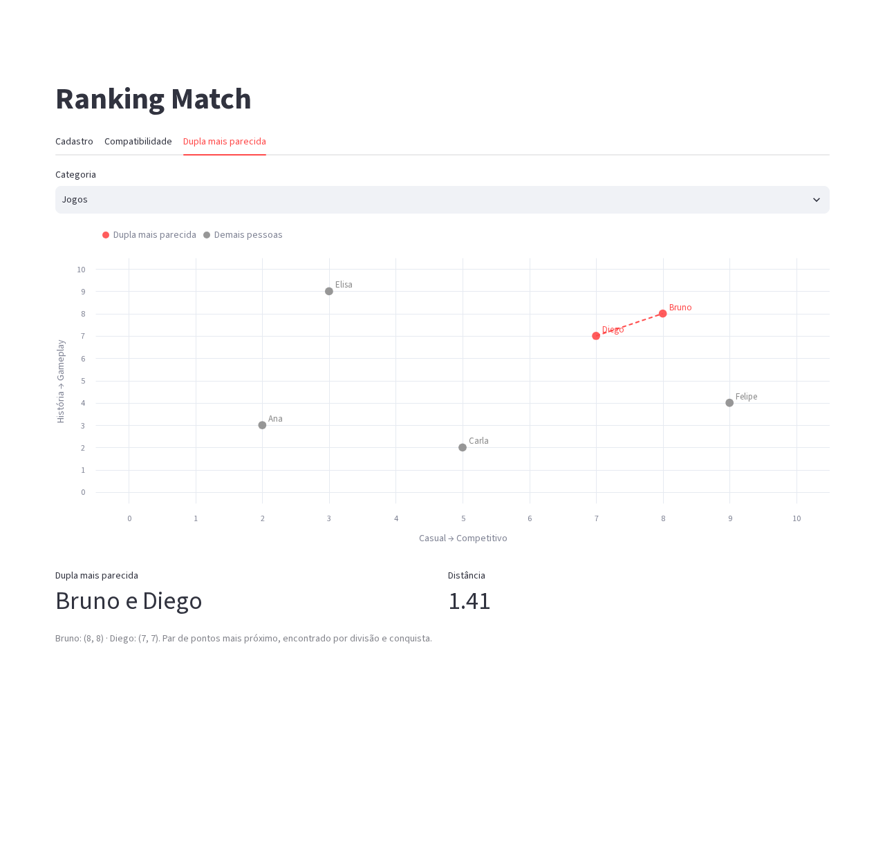

# Ranking Match

**Conteúdo da Disciplina**: Dividir e Conquistar<br>

## Alunos

| Matrícula | Aluno |
| -- | -- |
| xx/xxxxxxx | Eduardo Jesus Dal Pizzol |
| xx/xxxxxxx | Luana Carvalho |

## Sobre

O **Ranking Match** descobre afinidades entre pessoas a partir dos gostos delas em três categorias: **Jogos**, **Músicas** e **Séries/Animes**. Cada pessoa informa duas coisas por categoria:

- **Um ranking** dos 8 itens da categoria, do favorito ao menos favorito.
- **Um ponto (x, y)**, com notas de 0 a 10 em dois eixos que descrevem o gosto dela. Em Jogos, por exemplo, os eixos são *Casual → Competitivo* e *História → Gameplay*.

Com esses dados o app tem duas abas de resultado, cada uma resolvida por um algoritmo de divisão e conquista:

- **Compatibilidade**: o quanto os rankings de duas pessoas concordam, medido pela **contagem de inversões**. A aba mostra todas as pessoas da mais para a menos compatível e permite comparar duas lado a lado.
- **Dupla mais parecida**: as duas pessoas com gostos mais próximos na categoria, encontradas pelo **par de pontos mais próximo**. A aba mostra o gráfico das notas com a dupla destacada.

A aba **Cadastro** é onde as pessoas são criadas e preenchem o ranking e as notas.

### Algoritmos

#### Contagem de inversões: aba Compatibilidade

Os itens são percorridos na ordem do ranking da pessoa A, anotando a posição que a pessoa B deu a cada um. Cada **inversão** nessa sequência (um par `i < j` com `seq[i] > seq[j]`) é um par de itens em que as duas pessoas discordam sobre qual vem antes.

A contagem é feita com o *sort-and-count* (Kleinberg & Tardos, seção 5.3):

1. **Dividir:** a sequência é partida ao meio.
2. **Conquistar:** cada metade é ordenada e tem suas inversões contadas recursivamente.
3. **Combinar:** na intercalação das duas metades, sempre que um elemento da direita sai antes dos que ainda restam na esquerda, ele forma uma inversão com cada um deles. Todas são somadas de uma vez.

Complexidade **O(n log n)**, contra O(n²) de comparar todos os pares. A compatibilidade é `100 × (1 − inversões / total de pares)`, com `total de pares = n(n − 1)/2`. Com 8 itens, rankings idênticos dão 100% (0 inversões) e rankings invertidos dão 0% (28 inversões).

Implementação: [`algoritmos/inversoes.py`](algoritmos/inversoes.py).

#### Par de pontos mais próximo: aba Dupla mais parecida

Cada pessoa é um ponto (x, y) na categoria, e a dupla mais parecida é o par de pontos com a menor distância euclidiana. O algoritmo segue Kleinberg & Tardos, seção 5.4:

1. Os pontos são ordenados por x e por y **uma única vez**, no início.
2. **Dividir:** os pontos são separados em duas metades por uma reta vertical na mediana de x.
3. **Conquistar:** a menor distância de cada metade é calculada recursivamente; δ é a menor das duas.
4. **Combinar:** o único par que pode ser menor que δ cruza a reta. Por isso só entram na faixa de largura 2δ em torno dela os pontos já ordenados por y. Cada ponto da faixa só precisa ser comparado com os seguintes enquanto a diferença em y for menor que δ, o que dá no máximo 7 vizinhos.

Complexidade **O(n log n)**, contra O(n²) da força bruta. Até 3 pontos, o caso base compara todos os pares.

Implementação: [`algoritmos/par_mais_proximo.py`](algoritmos/par_mais_proximo.py).

Os dois algoritmos são testados contra uma força bruta O(n²) em 200 casos aleatórios cada, incluindo pontos repetidos e vários pontos com o mesmo x.

### Vídeo de apresentação

[Clique aqui para assistir ao vídeo de apresentação](LINK_DO_VIDEO)

## Screenshots

**Cadastro**: a pessoa clica nos itens do favorito ao menos favorito e ajusta as notas nos dois eixos da categoria.



**Compatibilidade**: as pessoas mais compatíveis com a selecionada e a comparação direta entre duas, com os rankings lado a lado.



**Dupla mais parecida**: notas da categoria no plano, com o par de pontos mais próximo destacado.



## Instalação

**Linguagem**: Python 3.10 ou superior<br>
**Framework**: Streamlit<br>
**Banco de dados**: SQLite (já vem com o Python)<br>

As dependências estão no [`requirements.txt`](requirements.txt): Streamlit, Altair e pytest.

1. Clone o repositório:

   ```bash
   git clone https://github.com/projeto-de-algoritmos-2026/G5_Dividir_e_Conquistar_PA-26.2-.git
   cd G5_Dividir_e_Conquistar_PA-26.2-
   ```

2. Crie e ative um ambiente virtual:

   ```bash
   # Linux / macOS
   python3 -m venv .venv
   source .venv/bin/activate

   # Windows (PowerShell)
   python -m venv .venv
   .venv\Scripts\Activate.ps1
   ```

3. Instale as dependências:

   ```bash
   pip install -r requirements.txt
   ```
